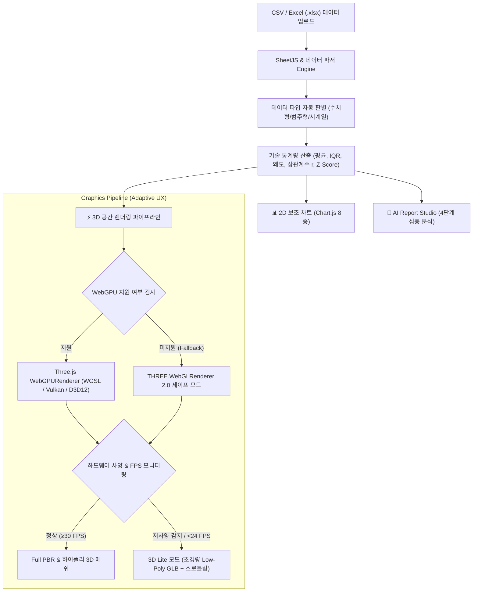

# 📊 3D & 2D 인터랙티브 데이터 분석 시스템 (2D_3D_Report1)

<div align="center">

[](https://app.notion.com/p/42383340231e8094972df457ecb7b0f6)
[](https://jsnwiw.github.io/2D_3D_Report1/)
[](https://github.com/jsnwiw/2D_3D_Report1)
[](LICENSE)

**⚡ Vulkan & WebGPU 차세대 GPU 가속 파이프라인 탑재 · 3D/2D 데이터 분석 & AI 자동 리포트 스튜디오**

<p align="center">
  <i>"단순한 시각화를 넘어, 저사양 디바이스 환경까지 배려하는 부드러운 60fps 인터랙티브 3D 경험과 직관적인 데이터 시각화 웹을 설계합니다."</i>
</p>

</div>

---

## 🌐 Quick Links & Demo
- 🔗 **노션 통합 포트폴리오 허브:** [https://app.notion.com/p/42383340231e8094972df457ecb7b0f6](https://app.notion.com/p/42383340231e8094972df457ecb7b0f6)
- 🚀 **라이브 배포 웹사이트:** [https://jsnwiw.github.io/2D_3D_Report1/](https://jsnwiw.github.io/2D_3D_Report1/)
- 📱 **모바일 & PWA 지원:** 모바일 홈 화면 설치 및 Service Worker 오프라인 캐싱 지원

---

## 🏗️ 시스템 아키텍처 (System Architecture)



---

## ⚡ 핵심 엔지니어링 & 성능 최적화 (v2.5.0)

1. **하이브리드 렌더러 파이프라인 (WebGPU & WebGL 2.0 Fallback)**
   - 브라우저 표준 저수준 그래픽스 API인 **WebGPU** 및 **Three.js WebGPURenderer** 기반 구동.
   - WebGPU 미지원 브라우저 진입 시 예외 크래시 없이 즉각 **WebGL 2.0 세이프 모드**로 무중단 자동 전환.

2. **선제적 하드웨어 프로파일링 & 에코 모드 (Eco Mode)**
   - `navigator.hardwareConcurrency` (<4 코어) 및 GPU 렌더러 정보를 렌더링 전 조기 감지.
   - 초경량 Low-Poly GLB 모델(36/8 tris) 탑재 및 24 FPS 저하 시 단계적 부하 완화.
   - `document.hidden` 감지 시 백그라운드 탭 렌더링을 일시 중지하여 불필요한 GPU/전력 소모 0% 유지.

3. **이벤트 루프 최적화**
   - **윈도우 리사이즈:** 150ms 디바운스 적용으로 연속 리사이즈 병목 차단.
   - **레이캐스팅:** `pointermove` 연산을 50ms 스로틀링하여 마우스/터치 이동 시 CPU 부하 대폭 절감.
   - **DOM 라벨 프로젝션:** 3D-2D 투영 라벨 좌표 갱신을 30 FPS로 제한하여 DOM Reflow/Repaint 억제.

4. **AI Report Studio 심층 분석 엔진 (4단계)**
   - 🔬 **1단계 표준 요약** ~ **4단계 풀스펙 종합 감사** 깊이 선택 지원.
   - 사분위수(IQR), 집중도(HHI), 피어슨 상관계수($r$), Stress Test, What-If 시뮬레이션, Z-Score 감사 자동 산출.

---

## 🛠️ Tech Stack

<div align="left">
  
  
  
  
  
  
  
  
  
</div>

---

## 📱 프로젝트 구조 (Project Structure)

```text
2D_3D_Report1/
├── index.html                  # 메인 엔트리포인트 (데스크톱/모바일 통합)
├── combined.html               # 모바일/데스크톱 반응형 뷰포트
├── desktop/                    # 데스크톱 전용 뷰 레이아웃
├── mobile/                     # 모바일 전용 뷰 레이아웃
├── js/
│   ├── renderer3d.js          # Three.js WebGPU / WebGL 렌더러 파이프라인
│   ├── lowSpecControl.js      # 저사양 감지 및 3D Lite 동적 폴백 제어
│   ├── ai-report.js           # 4단계 AI 분석 보고서 스튜디오 엔진
│   ├── ui.js                  # 인터랙션 및 모달 제어
│   └── patchNotes.js          # 패치 노트 모달 렌더링
├── css/
│   ├── figma-glass.css        # 피그마 글래스모피즘 UI 테마
│   └── common.css             # 공통 반응형 스타일
├── models/lowres/             # 초경량 Low-Poly GLB 모델 (36/8 tris)
├── scripts/                   # 패치 노트 자동화 CLI 스크립트
├── sw.js                      # Service Worker 오프라인 캐시
└── manifest.json              # PWA 모바일 설치 매니페스트
```

---

## 📬 Contact & Portfolio

- **Portfolio Hub:** [https://app.notion.com/p/42383340231e8094972df457ecb7b0f6](https://app.notion.com/p/42383340231e8094972df457ecb7b0f6)
- **GitHub:** [@jsnwiw](https://github.com/jsnwiw)
- **Email:** [jshbzjxhsbz@gmail.com](mailto:jshbzjxhsbz@gmail.com)
- **Phone:** 010-2920-8477
